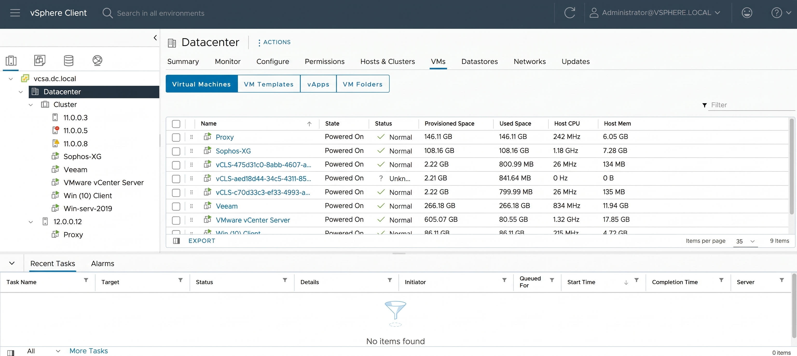
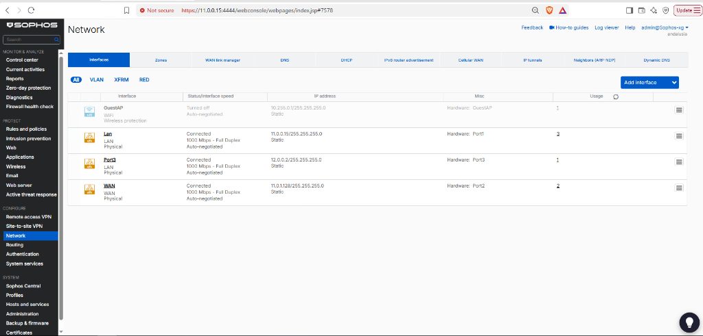
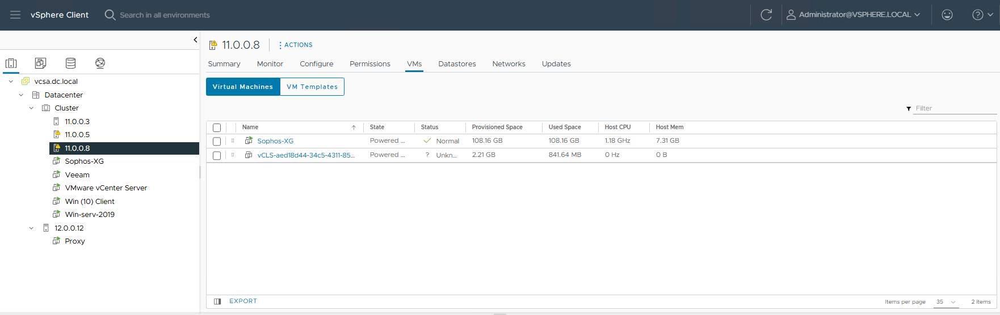
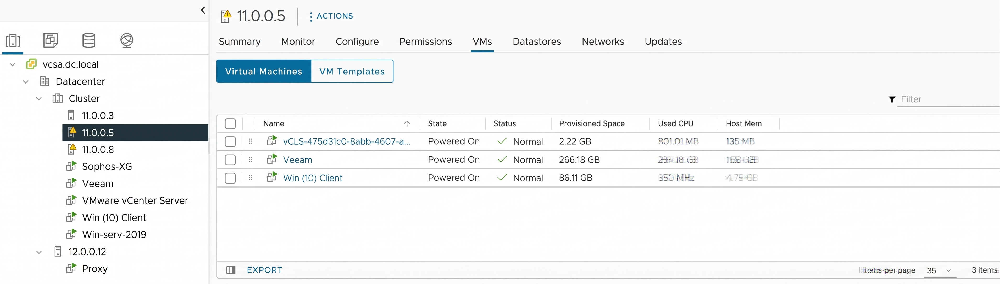
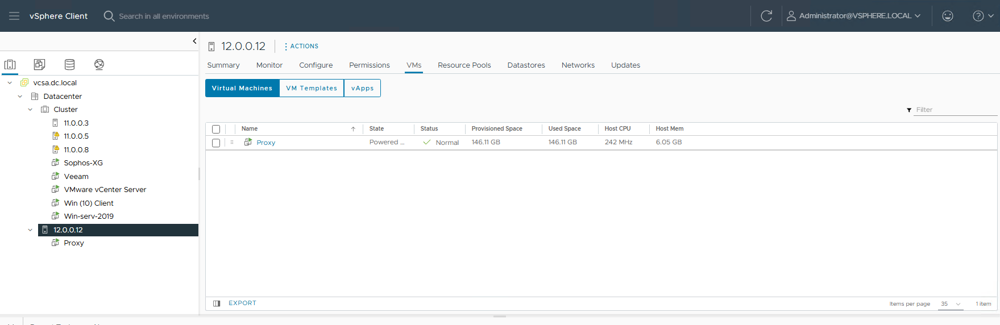

# Enterprise System Administration Home Lab

> **A real-world, enterprise-grade nested virtualization lab designed as a practical learning blueprint for System Administrators and IT Infrastructure Engineers.**

---

## 🎯 Project Objective & Purpose

This project is built from the perspective of an **Enterprise System Administrator**. The primary objective is to build, configure, and document a complete enterprise IT infrastructure from scratch using **Nested Virtualization**. 

Whether you are starting your journey in the **System Administration track** or looking to master enterprise datacenter design, this lab demonstrates hands-on implementation of:
- Multi-host nested hypervisors (VMware ESXi & vCenter).
- Multi-subnet segmentation with a dedicated Next-Generation Firewall (Sophos XG).
- Enterprise Identity & Directory Services (Windows Server 2019 Active Directory).
- Centralized Data Protection and Disaster Recovery (Veeam Backup & Replication).
- End-to-end routing, NAT, and traffic inspection between isolated network zones.

---

## 🖥️ Physical Host Specifications (Bare-Metal)

The entire nested datacenter is hosted on a high-spec physical dedicated server:

| Component | Specification |
| :--- | :--- |
| **Physical Server IP** | 10.100.14.17 |
| **Memory (RAM)** | **74 GB** High-Density RAM |
| **Storage Capacity** | **2 TB** Storage |
| **Base Hypervisor** | **VMware Workstation Pro** (Enabling Hardware-Assisted Nested Virtualization) |

---

## 🌐 Network Topology & Multi-Subnet Architecture

The lab is split into multiple isolated subnets interconnected and secured through a virtual **Sophos Firewall** operating as the core gateway and router.

```text
[ Physical Network / Internet ] (Physical Host: 10.100.14.17)
  │
  ▼ [Port 2: WAN (IP: 11.0.1.128/24)]
[ Sophos XG Firewall ] (VM on Host 11.0.0.8)
  │  Web Console: https://11.0.0.15:4444
  │  Core Router • Inter-Subnet Routing • Outbound NAT
  │
  ├──► [Port 1: LAN (IP: 11.0.0.15)] ── Subnet 11.0.0.0/24
  │     ├── ESXi Host 1 (11.0.0.3)
  │     │     ├── VMware vCenter Server (VCSA)
  │     │     └── Windows Server 2019 DC (AD DS, DNS, DHCP)
  │     ├── ESXi Host 2 (11.0.0.5)
  │     │     ├── Veeam Backup & Replication
  │     │     └── Windows 10 Enterprise Client
  │     └── ESXi Host 3 (11.0.0.8)
  │           └── Sophos Firewall Appliance
  │
  └──► [Port 3: LAN (IP: 12.0.0.2)]  ── Subnet 12.0.0.0/24
        └── ESXi Host 4 (12.0.0.12)
              └── Secondary Routed ESXi Host
```


### Subnet Allocation & Gateways

| Interface / Zone | IP Address | Subnet Mask | Gateway Role | Connected Workloads |
| :--- | :--- | :--- | :--- | :--- |
| **Port 2 (WAN)** | `11.0.1.128` | `255.255.255.0` | Uplink / NAT | Physical Network & Outbound Internet |
| **Port 1 (LAN)** | `11.0.0.15` | `255.255.255.0` | Default Gateway (`11.0.0.0/24`) | Core Management, vCenter, DC, Veeam, Hosts 1, 2, 3 |
| **Port 3 (LAN)** | `12.0.0.2` | `255.255.255.0` | Default Gateway (`12.0.0.0/24`) | Secondary Subnet & ESXi Host 4 (`12.0.0.12`) |

---

## 🏢 Cluster & Nested ESXi Hosts Overview

The environment deploys **4 Nested ESXi Hosts** across different subnets:

| Host Name | ESXi IP | Subnet | Hosted Virtual Machines & Roles |
| :--- | :--- | :--- | :--- |
| **ESXi Host 1** | 11.0.0.3 | 11.0.0.0/24 | • **VMware vCenter Server (VCSA)**<br>• **Primary Domain Controller** (Windows Server 2019 - AD DS, DNS, DHCP) |
| **ESXi Host 2** | 11.0.0.5 | 11.0.0.0/24 | • **Veeam Backup & Replication Server**<br>• **Windows 10 Enterprise Client** (Domain-Joined) |
| **ESXi Host 3** | 11.0.0.8 | 11.0.0.0/24 | • **Sophos XG Firewall** (Core Router with 3 NICs: WAN, Subnet 11, Subnet 12) |
| **ESXi Host 4** | 12.0.0.12 | 12.0.0.0/24 | • **Member ESXi Host** in secondary routed subnet |



---

## 🛡️ Core Infrastructure & Security Implementation

### 1. Sophos Firewall (Routing, NAT & Perimeter Security)

The virtual **Sophos XG Firewall** serves as the central router and perimeter security appliance for the entire lab:

* **Configured Network Interfaces:**
  - **Port 1 (LAN - `11.0.0.15/24`):** Connected to Subnet 11, acting as the primary gateway and hosting the Web Admin Console (`https://11.0.0.15:4444`).
  - **Port 2 (WAN - `11.0.1.128/24`):** Connected to the physical network with outbound NAT to provide internet connectivity to all internal VMs.
  - **Port 3 (LAN - `12.0.0.2/24`):** Connected to Subnet 12, serving as the gateway for ESXi Host 4 and its workloads.
* **Routing & Security Policies:**
  - **Inter-Subnet Routing:** Enables bidirectional routed traffic between Subnet `11.0.0.0/24` and Subnet `12.0.0.0/24`.
  - **Perimeter Defense:** Stateful firewall inspection, Layer 7 application rules, and NAT masquerading for WAN egress.





---

### 2. VMware vSphere & vCenter Management
* Centralized cluster management via **VMware vCenter Server Appliance (VCSA)**.
* Standard vSwitches and Port Groups segregating VM Traffic, Management, and Kernel interfaces across the hosts.

| ESXi Host 2 (11.0.0.5) | ESXi Host 4 (12.0.0.12) |
| :---: | :---: |
|  |  |

---

### 3. Identity, Directory & Network Services
* **Windows Server 2019 Domain Controller:**
  - Active Directory Domain Services (AD DS) forest and organizational unit (OU) structure.
  - DNS Server with forward and reverse lookup zones for all cluster hosts and VMs.
  - DHCP Server configured to distribute leases and options across the domain.
* **Client Integration:** Windows 10 client joined to the domain for testing GPOs and user privileges.

---

### 4. Data Protection & Disaster Recovery (Veeam)
* **Veeam Backup & Replication** deployed on Host 2 (11.0.0.5).
* Integrated directly with vCenter Server to protect VMs across all ESXi hosts.
* Automated backup jobs, backup repositories, and instant restore validation.

.jpg)

---

### 5. Storage & Virtual Networking
* Provisioned local and shared VMFS datastores across the nested hosts.
* Optimized virtual switches ensuring isolated broadcast domains and security policies.

| Datastores Overview | Virtual Networking |
| :---: | :---: |
| .jpg) | .jpg) |

---

## 🛠️ Skills & Technologies Demonstrated

* **Virtualization:** VMware ESXi 7.x/8.x, VMware vCenter Server (VCSA), VMware Workstation Pro.
* **Network & Security:** Sophos XG Firewall, Inter-VLAN / Inter-Subnet Routing, NAT, Firewall Rules.
* **Directory Services:** Active Directory Domain Services (AD DS), Group Policy (GPO), DNS, DHCP.
* **Operating Systems:** Windows Server 2019, Windows 10 Enterprise.
* **Backup & Recovery:** Veeam Backup & Replication (VADP, VM snapshot backups, file-level restores).

---

## 👨‍💻 Author

**Mostafa Kandeel**  
*Enterprise System Administrator & Infrastructure Engineer*  
[GitHub Profile](https://github.com/Mostafa-Kandeel)
