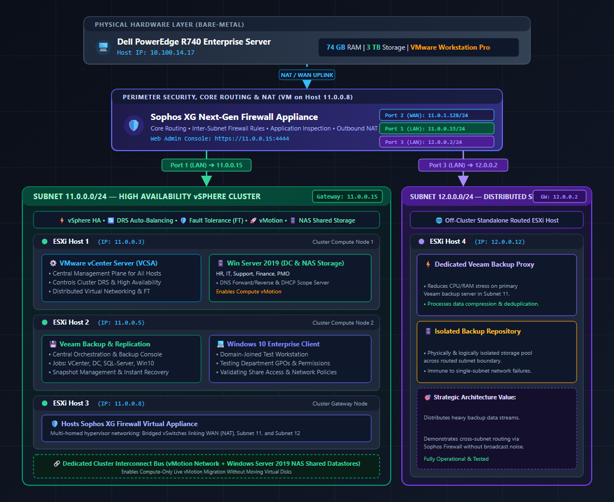
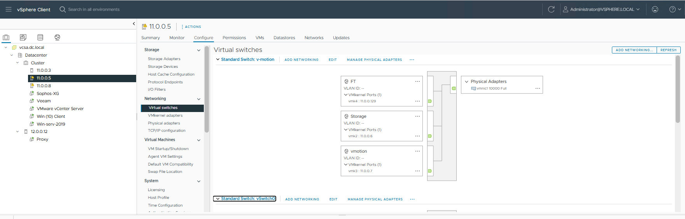
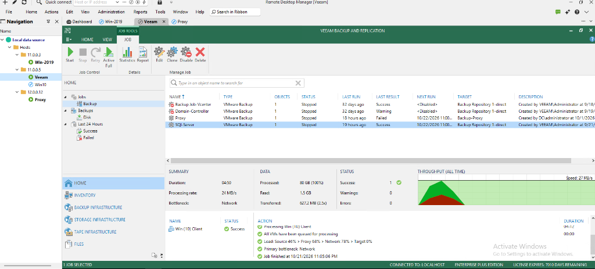
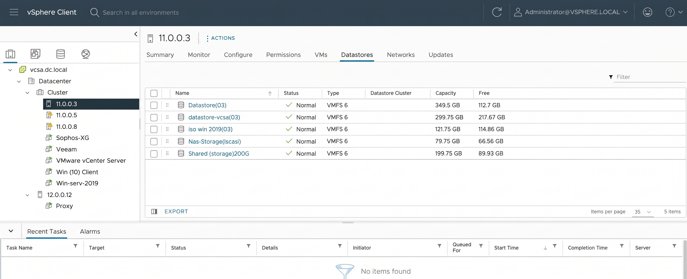
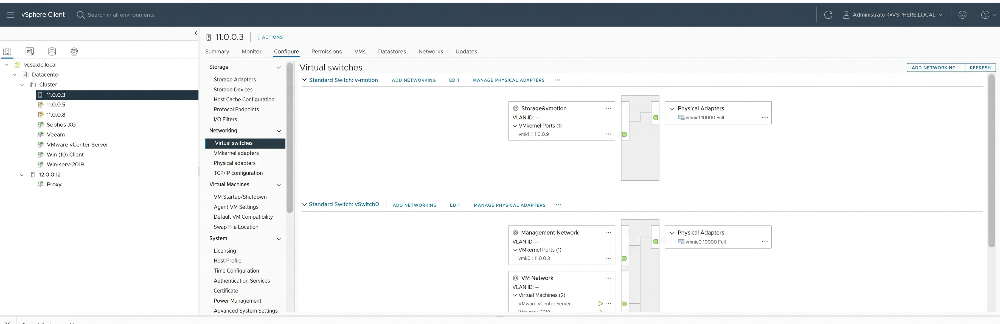
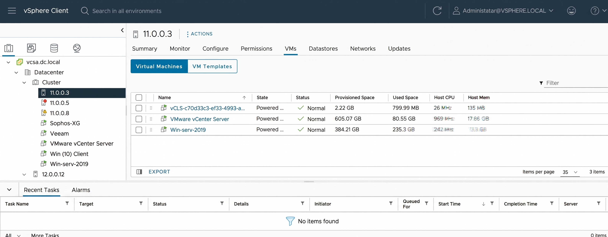

# Enterprise System Administration & Datacenter Lab

> **A production-grade, enterprise nested virtualization architecture designed as an end-to-end practical blueprint for System Administrators, Cloud Engineers, and Infrastructure Specialists.**

---

---

## 🎯 Project Overview & Core Objectives

### 💡 The Project Concept (فكرة المشروع)
In enterprise IT, mastering production-grade datacenter operations requires practical experience with multi-node hypervisors, clustering, perimeter security, directory services, and disaster recovery. However, obtaining multiple dedicated physical servers and enterprise licensing for testing is often cost-prohibitive.

This project solves that barrier by architecting a **Complete Enterprise Datacenter inside a Nested Virtualization Environment** hosted on a high-spec bare-metal server (**Dell PowerEdge R740** with **74 GB RAM** and **3 TB Storage**). By leveraging nested VMware ESXi hypervisors on VMware Workstation, this environment replicates a genuine, multi-tier corporate infrastructure—delivering real-world enterprise capabilities without hardware limitations.

### 🚀 Strategic Objectives (أهداف المشروع)
* **Practical Blueprint for System Administrators:** Built as an end-to-end, real-world reference for anyone studying or advancing in the **System Administration & Cloud Infrastructure track**, demonstrating how enterprise components tie together.
* **Realistic Corporate Simulation:** Models a real enterprise organization with 5 dedicated business departments (**HR, IT Operations, Call Center, Finance, and PMO**), implementing strict security boundaries, Active Directory Organizational Units (OUs), Group Policies (GPOs), and role-based access control.
* **Mastering High Availability & Clustering:** Hands-on implementation of enterprise availability standards: **vSphere DRS** for automatic workload balancing, **Fault Tolerance (FT)** & **vSphere HA** for zero-downtime protection, and **vMotion** live migration enabled by centralized **NAS Shared Storage**.
* **Zero-Trust Network Segmentation:** Practical implementation of multi-subnet isolation, Layer 7 firewall policies, and inter-subnet routing via a dedicated **Sophos XG Firewall**.
* **Enterprise Data Protection & Disaster Recovery:** Implementing a production-grade 3-tier backup architecture with **Veeam Backup & Replication**, including off-cluster distributed proxy load balancing.

---

## 🖥️ Physical Host Specifications (Bare-Metal Platform)

The entire enterprise datacenter is deployed on a dedicated, high-performance bare-metal rack server engineered for heavy virtualization workloads:

| Hardware Component | Enterprise Specification | Operational Role |
| :--- | :--- | :--- |
| **Server Hardware Model** | **Dell PowerEdge R740 Rack Server** | High-performance enterprise compute platform |
| **Management IP** | `10.100.14.17` | Physical out-of-band / host management access |
| **Physical Memory (RAM)** | **74 GB** DDR4 High-Density ECC RAM | Dedicated allocation for nested hypervisors & VMs |
| **Storage Capacity** | **3 TB** High-Speed Enterprise Storage | Provisioned for nested datastores and shared pools |
| **Base Virtualization Engine** | **VMware Workstation Pro** | Hardware-Assisted Nested Virtualization (Intel VT-x/EPT) |

---

## 🏛️ vCenter Cluster & Datacenter Architecture

At the core of the infrastructure is a centralized **VMware vCenter Server Appliance (VCSA)** orchestrating a multi-host environment divided into a High-Availability Enterprise Cluster and an off-cluster Distributed Services Host:

### 🌟 High Availability & Resiliency Features (Hosts 1, 2, 3 Cluster):
* **vSphere DRS (Distributed Resource Scheduler):** Dynamically monitors CPU and RAM utilization across cluster nodes (`11.0.0.3`, `11.0.0.5`, `11.0.0.8`) and automatically balances workloads via live migration to prevent performance bottlenecks.
* **Fault Tolerance (FT) & vSphere HA:** Ensures business continuity with zero downtime. If any physical or nested host experiences failure, critical VMs fail over instantly without data loss.
* **Dedicated vMotion & Migration Network:** Optimized virtual switches and VMkernel interfaces configured specifically for seamless, zero-interruption live VM migration.
* **Centralized NAS Shared Storage:** Windows Server 2019 functions as a **NAS / Shared Storage Server**, exposing centralized shared datastores to the ESXi cluster. This enables compute-only vMotion migrations without needing to copy heavy virtual disks across hosts.

<p align="center">
  
</p>

---

## 🌐 Network Topology & Multi-Subnet Architecture

The virtual infrastructure is architected across multiple segregated subnets interconnected and protected by a central **Sophos XG Next-Generation Firewall** serving as the core router and security gateway.

<p align="center">
  
</p>

<details>
  <summary><b>🔍 Click to view Text-Based Topology Blueprint</b></summary>

```text
+--------------------------------------------------------------------+
|                   PHYSICAL INFRASTRUCTURE LAYER                    |
+--------------------------------------------------------------------+
 [ Dell PowerEdge R740 ]  ── Physical Host IP: 10.100.14.17
   └── VMware Workstation Pro (Nested Virtualization: 74GB RAM / 3TB)
                                 │
                                 ▼ (Uplink / NAT)
+--------------------------------------------------------------------+
|             PERIMETER SECURITY & INTER-SUBNET ROUTING              |
+--------------------------------------------------------------------+
 [ Sophos XG Firewall VM ] (Hosted on ESXi Host 3: 11.0.0.8)
   • Web Admin Console: https://11.0.0.15:4444
   • Port 2 (WAN): 11.0.1.128/24 ── Outbound NAT & Internet Egress
   • Port 1 (LAN): 11.0.0.15/24  ── Core Gateway for Subnet 11
   • Port 3 (LAN): 12.0.0.2/24   ── Core Gateway for Subnet 12
        │                                         │
        │ [Port 1: LAN]                           │ [Port 3: LAN]
        ▼                                         ▼
+---------------------------------+   +------------------------------+
| SUBNET 11.0.0.0/24 (HA CLUSTER) |   | SUBNET 12.0.0.0/24 (SERVICES)|
+---------------------------------+   +------------------------------+
 Gateway IP: 11.0.0.15                 Gateway IP: 12.0.0.2
 ├── High Availability (vSphere HA)    └── Standalone Routed ESXi Host
 ├── Auto Load-Balancing (DRS)
 ├── Continuous Uptime (FT)
 ├── Dedicated vMotion Network
 └── Shared Storage: Win2019 NAS
 │
 ├── [ESXi Host 1] 11.0.0.3            └── [ESXi Host 4] 12.0.0.12
 │    ├── VMware vCenter (VCSA)             ├── Veeam Backup Proxy VM
 │    └── Windows Server 2019 DC            └── Backup Repository Target
 │         • Domain Controller                   • Offloads Backup Load
 │         • NAS Shared Storage                  • Cross-Subnet DR
 │         • OUs: HR, IT, Support,
 │                Finance, PMO
 │
 ├── [ESXi Host 2] 11.0.0.5
 │    ├── Veeam Backup & Replication
 │    └── Windows 10 Client (Testing)
 │
 └── [ESXi Host 3] 11.0.0.8
      └── Sophos XG Firewall VM
+--------------------------------------------------------------------+
```

</details>

### 📋 Sophos Firewall Network Interfaces & Gateway Mapping

| Interface | Zone | IP Address | Subnet Mask | Operational Function |
| :--- | :--- | :--- | :--- | :--- |
| **Port 2 (WAN)** | WAN | `11.0.1.128` | `255.255.255.0` | Uplink to Physical Network & Outbound Internet via NAT |
| **Port 1 (LAN)** | LAN | `11.0.0.15` | `255.255.255.0` | Default Gateway for Subnet `11.0.0.0/24` & Admin Web Console |
| **Port 3 (LAN)** | LAN | `12.0.0.2` | `255.255.255.0` | Default Gateway for Subnet `12.0.0.0/24` (Backup & Secondary Zone) |

<p align="center">
  
</p>

---

## 🏢 In-Depth Host Breakdown & Workload Distribution

### 1️⃣ ESXi Host 1 (`11.0.0.3`) — Management & Enterprise Identity Core
* **Subnet:** `11.0.0.0/24` (Cluster Member)
* **Hosted Virtual Machines:**
  1. **VMware vCenter Server Appliance (VCSA):** Central management plane for the ESXi hosts, cluster features (DRS/HA/FT), virtual networking, and storage provisioning.
  2. **Windows Server 2019 (Domain Controller & Centralized Management):**
     * **Active Directory Domain Services (AD DS):** Designed to simulate a real enterprise corporate hierarchy with segregated Organizational Units (OUs), Security Groups, and Group Policy Objects (GPOs) for key departments:
       - 👥 **HR (Human Resources):** Employee accounts, departmental shares, and privacy GPOs.
       - 💻 **IT Operations:** Administrative tier accounts, management tools, and elevated rights.
       - 🎧 **Call Center / Support:** Restricted workstation policies and customer support apps.
       - 💰 **Finance & Accounting:** High-security financial resources and restricted file access.
       - 📊 **PMO (Project Management Office):** Cross-functional project access and collaboration.
     * **Core Network Services:** Windows DNS with forward/reverse lookup zones and DHCP Server.
     * **NAS / Shared Storage Server:** Configured to share centralized storage volumes via SMB/NFS/iSCSI to the ESXi cluster for live migrations.

---

### 2️⃣ ESXi Host 2 (`11.0.0.5`) — Central Data Protection & Testing
* **Subnet:** `11.0.0.0/24` (Cluster Member)
* **Hosted Virtual Machines:**
  1. **Veeam Backup & Replication Management Server:** Enterprise backup orchestration handling automated backup jobs, schedules, VM snapshots, and instant recovery.
  2. **Windows 10 Enterprise Client:** Fully domain-joined test workstation used to validate Group Policy enforcement, department user logins, permissions, and network share access.

<p align="center">
  
</p>

---

### 3️⃣ ESXi Host 3 (`11.0.0.8`) — Perimeter Defense & Inter-Subnet Routing
* **Subnet:** `11.0.0.0/24` (Cluster Member)
* **Hosted Virtual Machines:**
  1. **Sophos XG Next-Gen Firewall Appliance:**
     * Multi-homed with 3 virtual NICs linking WAN, Subnet 11, and Subnet 12.
     * Functions as the core Layer 3 router enabling bidirectional communication between `11.0.0.0/24` and `12.0.0.0/24`.
     * Stateful packet inspection, application-level security policies, and NAT masquerading for WAN egress.

<p align="center">
  
</p>

---

### 4️⃣ ESXi Host 4 (`12.0.0.12`) — Distributed Backup Proxy & Repository
* **Subnet:** `12.0.0.0/24` (Secondary Routed Subnet — Standalone Host)
* **Hosted Virtual Machines:**
  1. **Dedicated Veeam Backup Proxy & Backup Repository VM:**
     * Strategically placed outside the primary cluster on an independent subnet to avoid resource contention with production workloads.
     * **Load Balancing:** Offloads heavy data processing, deduplication, and compression tasks from the default backup proxy.
     * **Isolated Repository:** Provides a distributed backup storage target across network boundaries for enhanced disaster recovery readiness.

<p align="center">
  
</p>

---

## 💾 Centralized Backup & Disaster Recovery (Veeam Engine)

The environment utilizes an enterprise-grade data protection architecture powered by **Veeam Backup & Replication (Enterprise Plus)**:

* **Active Backup Jobs:** Automated image-level, application-consistent VM backups protecting:
  - `Backup Job-Vcenter`: Full orchestration plane protection.
  - `Domain-Controller`: Active Directory system state and granular object recovery.
  - `SQL-Server`: Database-level transaction log and VM protection.
  - `Win (10) Client`: Workstation state and user data backup.
  - `Proxy`: Backup infrastructure health and state protection.
* **Performance Metrics:** Proven throughput with 2.5x deduplication/compression ratio and verified network transfer efficiency.

<p align="center">
  
</p>

---

## 🗄️ Storage & Virtual Networking Infrastructure

### High-Speed Datastores
* VMFS datastores provisioned across all ESXi nodes, supplemented by the Windows Server 2019 NAS shared storage target.
* Thin and thick provisioning monitored to optimize storage capacity and VM performance.

<p align="center">
  
</p>

### vSphere Virtual Switches & VM Inventory
* Custom Port Groups segregating Management traffic, vMotion live migration channels, and VM Production networks.
* Complete inventory view across nested nodes.

<p align="center">
  
  
</p>

---

## 🛠️ Summary of Implemented Technologies & Competencies

| Domain | Implemented Technologies & Concepts |
| :--- | :--- |
| **Virtualization Platforms** | VMware ESXi 7.x/8.x, VMware vCenter Server (VCSA), VMware Workstation Pro |
| **High Availability & Clustering** | VMware DRS (Distributed Resource Scheduler), vSphere HA, Fault Tolerance (FT), vMotion |
| **Network & Perimeter Security** | Sophos XG Firewall, Inter-Subnet / Inter-VLAN Routing, NAT Masquerading, Stateful Packet Inspection |
| **Identity & Access Management** | Microsoft Windows Server 2019 AD DS, Departmental OUs (HR, IT, Call Center, Finance, PMO), Group Policy (GPOs), DNS, DHCP |
| **Storage Architecture** | VMFS Datastores, Windows Server 2019 NAS / Shared Storage for Compute-Only vMotion Migration |
| **Backup & Disaster Recovery** | Veeam Backup & Replication (Enterprise Plus), Distributed Backup Proxies, Secondary Subnet Repository, Granular Item Recovery |

---

## 👨‍💻 Author

**Mostafa Kandeel**  
*Enterprise System Administrator & Infrastructure Engineer*  
[GitHub Profile](https://github.com/Mostafa-Kandeel)
